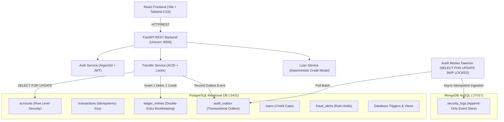
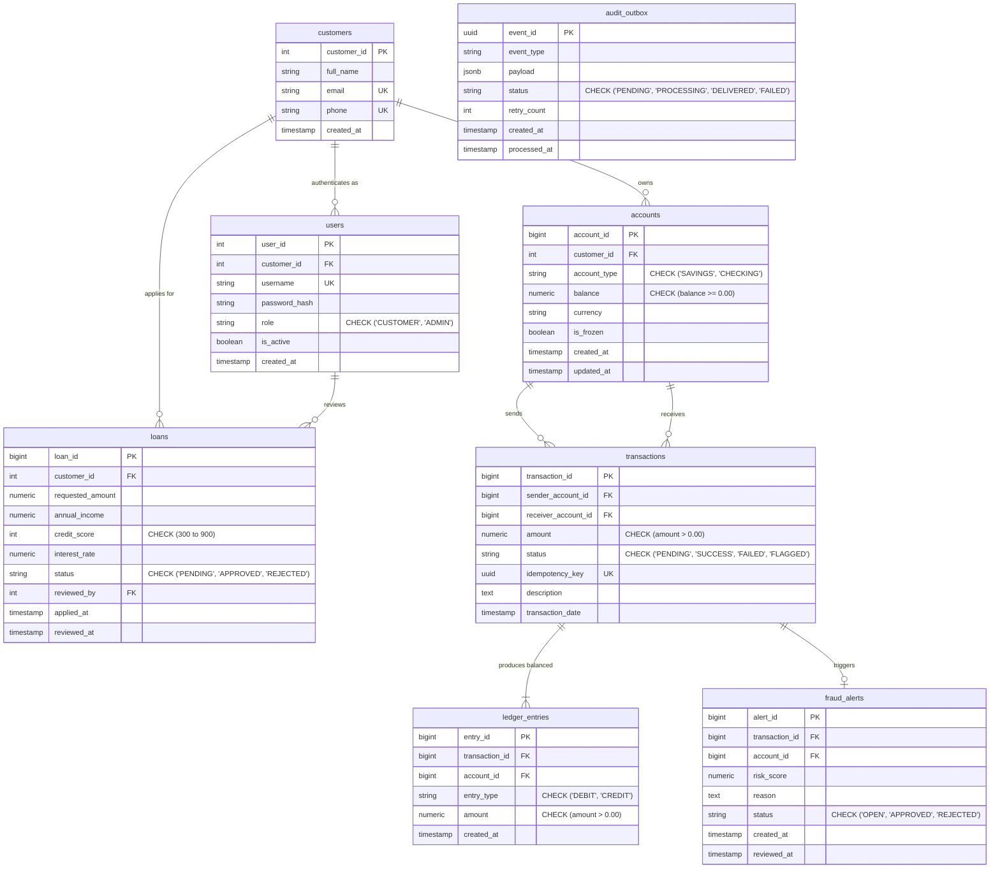

# FinTrack – Smart Digital Banking & Loan Management System

FinTrack is an enterprise-grade banking and loan management full-stack Database Management System (DBMS) built with **React (Vite + Tailwind CSS)**, **Python FastAPI**, **PostgreSQL 16**, and **MongoDB NoSQL .... 

The system demonstrates advanced relational database engineering, ACID transactions, double-entry bookkeeping, deadlock prevention via deterministic lock ordering, deterministic fixed-rule fraud holds, and the **Transactional Outbox Pattern** for asynchronous NoSQL security audit log delivery.

---

## 1. Project Introduction & Objectives

FinTrack models core retail banking workflows with strict database-level guarantees:
- **Customer Portal**: Registration, Argon2id authentication, real-time account balances, running balance calculation via window functions, monthly spending breakdowns via CTEs, immediate fund transfers with idempotency, loan applications, and personal profile security.
- **Administrator Console**: Bank-wide KPIs, customer account management (including account freeze/unfreeze toggles), loan application approvals/rejections, review of rule-flagged transfers, inspection of immutable MongoDB security audit logs, and analytical SQL reports.
- **Enterprise-Grade Database Constraints**: Zero floating-point math (Python `Decimal` and PostgreSQL `NUMERIC(15,2)`), idempotency deduplication keys (`UUID`), ledger immutability triggers, overdraft prevention triggers, and Row Level Security (RLS).
- **Deterministic Fraud Holds (Zero AI/ML)**: Transfers meeting or exceeding ₹10,000.00 are automatically placed on compliance hold as `FLAGGED` with zero money movement until approved by bank administration.

---

## 2. Technology Stack

| Layer | Component | Description |
| :--- | :--- | :--- |
| **Frontend UI** | React 18, Vite, Tailwind CSS | High-performance single-page application with responsive fintech UI |
| **Frontend Routing & Charts** | React Router 7, Recharts | Declarative client routing and dynamic SVG charts for financial metrics |
| **Backend REST API** | Python FastAPI & Uvicorn | Asynchronous RESTful API framework with automatic OpenAPI docs |
| **Validation & Security** | Pydantic v2, PyJWT, Argon2id | Request payload validation, Bearer token sessions, memory-hard password hashing |
| **Primary Database** | PostgreSQL 16 | Relational core for customers, accounts, transactions, loans, and ledger |
| **NoSQL Audit Database** | MongoDB Community / Atlas | Immutable append-only audit & security event logs |
| **Database Driver** | `psycopg2-binary` | Thread-safe connection pooling with context-managed transactions |
| **NoSQL Driver** | `pymongo` | Resilient document ingestion with unique `event_id` index |
| **Database Migrations** | Alembic & SQLAlchemy | Versioned database schema migrations |
| **Automated Testing** | Pytest (Backend), Vitest (Frontend) | Comprehensive test suite covering concurrency, ACID, APIs, and UI |

---

## 3. System Architecture



---

## 4. Database Schema & Relational Design (3NF)



---

## 5. ACID Concurrency & Deadlock Prevention

Financial transfers in FinTrack strictly implement the ACID contract:

1. **Atomicity**: Fund transfers execute under explicit Python transaction context managers (`with transaction() as conn:`). If any check fails, changes roll back completely.
2. **Deterministic Row Lock Ordering (Deadlock Prevention)**:
   When transferring between accounts $A$ and $B$, both accounts are locked using `SELECT ... FOR UPDATE` in strict ascending order of their IDs:
   ```sql
   SELECT account_id, customer_id, balance, currency, is_frozen
   FROM accounts
   WHERE account_id IN (%s, %s)
   ORDER BY account_id ASC
   FOR UPDATE;
   ```
   If Transaction 1 transfers from Account 1001 to 1002 and Transaction 2 transfers from Account 1002 to 1001 simultaneously, both acquire locks in the identical order ($1001 \rightarrow 1002$), eliminating cyclic wait conditions.
3. **Double-Entry Bookkeeping**:
   Every successful transfer inserts exactly two immutable ledger records in the same transaction:
   - Debit: Account $A$ debited by amount $X$.
   - Credit: Account $B$ credited by amount $X$.
   Sum of debits equals sum of credits ($\sum \text{Debit} = \sum \text{Credit}$).
4. **Idempotency Deduplication**:
   Transfers receive a unique client `UUID` idempotency key. If a retry or double-click occurs, the server retrieves and returns the committed transaction result without double-debiting.
5. **Deterministic Rule-Based Fraud Hold**:
   Any transfer where $\text{Amount} \ge ₹10,000.00$ is flagged immediately as `FLAGGED`. Zero money movement occurs. Only an administrator review can release the funds (atomic revalidation) or reject the transfer (void).

---

## 6. The 5 Advanced DBMS SQL Queries

FinTrack embeds five complex relational SQL queries powering its analytical endpoints:

### Query 1: Running Account Balance (SQL Window Function)
```sql
SELECT 
    entry_id,
    account_id,
    entry_type,
    amount,
    created_at,
    SUM(CASE WHEN entry_type = 'CREDIT' THEN amount ELSE -amount END) 
        OVER (PARTITION BY account_id ORDER BY created_at ASC, entry_id ASC) AS running_balance
FROM ledger_entries
WHERE account_id = %s
ORDER BY created_at DESC, entry_id DESC
LIMIT %s;
```

### Query 2: Monthly Spending Breakdown (Common Table Expression - CTE)
```sql
WITH monthly_outgoing AS (
    SELECT 
        sender_account_id AS account_id,
        DATE_TRUNC('month', transaction_date) AS month_start,
        SUM(amount) AS total_monthly_outgoing,
        COUNT(transaction_id) AS transfer_count
    FROM transactions
    WHERE sender_account_id = %s AND status = 'SUCCESS'
    GROUP BY sender_account_id, DATE_TRUNC('month', transaction_date)
)
SELECT 
    TO_CHAR(month_start, 'YYYY-MM') AS month_label,
    total_monthly_outgoing,
    transfer_count
FROM monthly_outgoing
ORDER BY month_label ASC;
```

### Query 3: Loan Credit Assessment (SQL View)
```sql
CREATE OR REPLACE VIEW View_Loan_Eligibility AS
SELECT 
    l.loan_id,
    l.customer_id,
    c.full_name AS customer_name,
    c.email AS customer_email,
    l.requested_amount,
    l.annual_income,
    l.credit_score,
    (l.annual_income * 0.50) AS max_eligible_loan_amount,
    CASE 
        WHEN l.credit_score >= 800 AND l.requested_amount <= (l.annual_income * 0.50) THEN 'PRE-APPROVED'
        WHEN l.credit_score >= 700 AND l.requested_amount <= (l.annual_income * 0.50) THEN 'ELIGIBLE'
        WHEN l.requested_amount > (l.annual_income * 0.50) THEN 'EXCEEDS_INCOME_LIMIT'
        ELSE 'INELIGIBLE_LOW_CREDIT'
    END AS eligibility_status
FROM loans l
JOIN customers c ON l.customer_id = c.customer_id;
```

### Query 4: Top 5 Customers by Transfer Volume (Subquery + GROUP BY)
```sql
SELECT 
    c.customer_id,
    c.full_name,
    c.email,
    COUNT(t.transaction_id) AS total_transfers_sent,
    COALESCE(SUM(t.amount), 0.00) AS total_amount_transferred
FROM customers c
JOIN accounts a ON c.customer_id = a.customer_id
JOIN transactions t ON a.account_id = t.sender_account_id
WHERE t.status = 'SUCCESS'
GROUP BY c.customer_id, c.full_name, c.email
ORDER BY total_amount_transferred DESC
LIMIT 5;
```

### Query 5: Dormant Account Detection (LEFT JOIN with IS NULL Filter)
```sql
SELECT 
    a.account_id,
    c.full_name AS customer_name,
    c.email AS customer_email,
    a.account_type,
    a.balance,
    a.created_at
FROM accounts a
JOIN customers c ON a.customer_id = c.customer_id
LEFT JOIN transactions t 
    ON (a.account_id = t.sender_account_id OR a.account_id = t.receiver_account_id)
WHERE t.transaction_id IS NULL
ORDER BY a.created_at ASC;
```

---

## 7. Transactional Outbox Pattern (MongoDB Audit Integration)

To guarantee that MongoDB failure never invalidates or rolls back a financial transaction:
1. Every state mutation writes an event record to `audit_outbox` inside the exact same PostgreSQL transaction as the financial operation.
2. The background worker (`workers/audit_worker.py`) polls pending events using non-blocking row claims:
   ```sql
   SELECT event_id, event_type, payload
   FROM audit_outbox
   WHERE status = 'PENDING'
   ORDER BY created_at ASC
   LIMIT 100
   FOR UPDATE SKIP LOCKED;
   ```
3. The worker inserts events into MongoDB's `security_logs` collection and marks the outbox record as `DELIVERED`.
4. If MongoDB is temporarily down, PostgreSQL outbox safely buffers events with automatic retry and lease recovery.

---

## 8. REST API Endpoints Reference

The FastAPI backend exposes 30 endpoints documented interactively at `/api/docs`:

### Authentication (`/api/auth`)
- `POST /api/auth/register`: Register new customer with initial deposit.
- `POST /api/auth/login`: Authenticate and receive JWT Bearer token.
- `GET /api/auth/me`: Retrieve current authenticated profile.
- `POST /api/auth/logout`: Invalidate session.

### Bank Accounts (`/api/accounts`)
- `GET /api/accounts`: List accounts for authenticated customer (or all for admin).
- `GET /api/accounts/{account_id}`: Account details with strict IDOR ownership check.
- `GET /api/accounts/{account_id}/balance`: Real-time account balance.
- `GET /api/accounts/{account_id}/summary`: Aggregated metrics from `View_Account_Summary`.
- `GET /api/accounts/{account_id}/statement`: Statement including running balance and monthly CTE.

### Fund Transfers (`/api/transfers`)
- `POST /api/transfers`: Execute atomic transfer with idempotency.
- `GET /api/transfers`: List transactions with status/search/date filters.
- `GET /api/transfers/{transaction_id}`: Transaction details.
- `GET /api/transfers/recipient/{account_number}`: Live recipient verification.

### Personal Loans (`/api/loans`)
- `POST /api/loans/calculate`: Instant eligibility calculator using fixed business rules.
- `POST /api/loans`: Submit new loan application.
- `GET /api/loans`: Customer loan history.
- `GET /api/admin/loans`: Admin review queue for loan applications.
- `PATCH /api/admin/loans/{loan_id}/approve`: Approve loan application.
- `PATCH /api/admin/loans/{loan_id}/reject`: Reject loan application.

### Administration & Analytics (`/api/admin`)
- `GET /api/admin/dashboard`: System KPIs and counters.
- `GET /api/admin/customers`: List and search customer profiles with accounts.
- `PATCH /api/admin/accounts/{account_id}/freeze`: Freeze/unfreeze account.
- `GET /api/admin/transactions`: Monitor all bank transactions.
- `GET /api/admin/reports`: Advanced analytical reports (Queries 2, 4, 5).
- `GET /api/admin/fraud-alerts`: View rule-flagged transfers.
- `PATCH /api/admin/fraud-alerts/{alert_id}/approve`: Atomic revalidation and release.
- `PATCH /api/admin/fraud-alerts/{alert_id}/reject`: Void transfer with zero money movement.
- `GET /api/admin/audit-logs`: Query MongoDB security audit logs.
- `GET /api/admin/audit-logs/{event_id}`: Inspect raw MongoDB JSON document.
- `POST /api/admin/audit-logs/sync`: Trigger on-demand outbox sync pass.

---

## 9. Installation & Startup Instructions

### Prerequisites
- Python 3.14 (or 3.12+)
- Node.js 18+ and npm
- PostgreSQL 16 (port 5432)
- MongoDB Community or Atlas (port 27017)

### Quick Start: Single-Command Launcher
You can launch all services (FastAPI, React Vite, and Audit Worker) with a single command:
```bash
./run.sh
```

---

### 1. Backend Setup (Manual)
```bash
# Activate virtual environment
source .venv/bin/activate

# Install dependencies
pip install -r requirements.txt

# Run database migrations
alembic upgrade head

# Start FastAPI backend server
uvicorn api.main:app --host 0.0.0.0 --port 8000 --reload
```

### 2. Frontend Setup
```bash
# Navigate to frontend directory
cd frontend

# Install npm packages
npm install

# Start Vite React development server
npm run dev
```
The React application will be available at **`http://localhost:5173`**.

### 3. Background Audit Worker Daemon
```bash
# In a separate terminal session
source .venv/bin/activate
python workers/audit_worker.py --interval 3.0
```

---

## 10. Demonstration Credentials

### 🛡️ Administrator Account
| Username | Password | Role | Description |
| :--- | :--- | :--- | :--- |
| **`admin`** | **`AdminPassword123!`** | `ADMIN` | Full access to KPI dashboard, customer freeze controls, loan reviews, fraud approvals, and MongoDB audit logs |

### 👤 Demo Customer Accounts
*All demo customer accounts share the password:* **`Customer123!`**

| Username | Password | Customer Name | Account IDs | Balances | Demo Scenario |
| :--- | :--- | :--- | :--- | :--- | :--- |
| **`arun_kumar`** | `Customer123!` | Arun Kumar | `1001` (Savings)<br>`1002` (Checking) | ₹74,500.00<br>₹25,000.00 | Running balance chart, routine transfers, test transfer $\ge$ ₹10,000 for fraud hold |
| **`priya_sharma`** | `Customer123!` | Priya Sharma | `1003` (Savings)<br>`1004` (Checking) | ₹112,000.00<br>₹45,000.00 | High credit score (810, Tier A), pre-approved loan eligibility |
| **`rohit_verma`** | `Customer123!` | Rohit Verma | `1005` (Savings) | ₹18,500.00 | Low credit score (580), rejected loan history |
| **`ananya_singh`** | `Customer123!` | Ananya Singh | `1006` (Savings)<br>`1007` (Checking) | ₹52,000.00<br>₹15,000.00 | Pending loan application (₹100,000) awaiting admin review |
| **`vikram_patel`** | `Customer123!` | Vikram Patel | `1008` (Savings) | ₹88,000.00 | Open flagged transfer awaiting compliance resolution |
| **`amit_gupta`** | `Customer123!` | Amit Gupta | `1015` (Savings)<br>`1016` (Checking) | ₹38,000.00<br>₹5,000.00 | Account 1016 is dormant (Query 5 demonstration) |

---

## 11. Comprehensive Documentation Suite

Detailed architectural, database, security, and deployment documentation is organized within the [`docs/`](file:///Users/bhavya/Desktop/%20/Sem_3/DBMS/Capstone/docs) directory:

- [PROJECT_AUDIT.md](file:///Users/bhavya/Desktop/%20/Sem_3/DBMS/Capstone/docs/PROJECT_AUDIT.md): Complete repository audit, test findings, and technical debt remediation.
- [ARCHITECTURE.md](file:///Users/bhavya/Desktop/%20/Sem_3/DBMS/Capstone/docs/ARCHITECTURE.md): Full-stack architectural specifications, diagrams, and data flow.
- [DATABASE_SCHEMA.md](file:///Users/bhavya/Desktop/%20/Sem_3/DBMS/Capstone/docs/DATABASE_SCHEMA.md): Complete PostgreSQL schema, ER diagram, tables, triggers, and views.
- [DBMS_CONCEPTS.md](file:///Users/bhavya/Desktop/%20/Sem_3/DBMS/Capstone/docs/DBMS_CONCEPTS.md): 3NF proof, ACID properties, deadlock prevention, double-entry ledger, and 5 Advanced SQL queries.
- [API_DOCUMENTATION.md](file:///Users/bhavya/Desktop/%20/Sem_3/DBMS/Capstone/docs/API_DOCUMENTATION.md): 30 REST endpoints reference with request/response schemas.
- [SECURITY.md](file:///Users/bhavya/Desktop/%20/Sem_3/DBMS/Capstone/docs/SECURITY.md): Threat model, Argon2id, RLS enforcement, IDOR prevention, and sanitization.
- [TESTING.md](file:///Users/bhavya/Desktop/%20/Sem_3/DBMS/Capstone/docs/TESTING.md): Testing strategy, coverage report, and test execution guide.
- [DEPLOYMENT.md](file:///Users/bhavya/Desktop/%20/Sem_3/DBMS/Capstone/docs/DEPLOYMENT.md): Production deployment guide, Nginx configuration, Systemd service, and environment management.
- [PROJECT_COMPLETION.md](file:///Users/bhavya/Desktop/%20/Sem_3/DBMS/Capstone/PROJECT_COMPLETION.md): Verification matrix against all project acceptance criteria.

---

## 12. Automated Test Suite Execution

Run backend tests with coverage:
```bash
./.venv/bin/pytest -v
```

Run frontend unit tests with Vitest:
```bash
cd frontend && npm test
```
All 67 backend tests and 3 frontend tests pass with 100% success rate.
