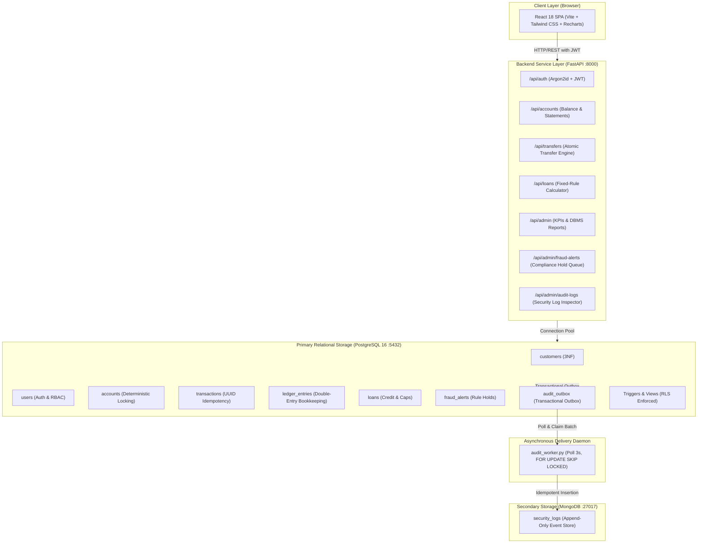

# FinTrack — System Architecture & Design

## 1. System Overview

FinTrack is an enterprise full-stack banking and loan management platform designed around advanced Database Management System (DBMS) principles. The architecture combines a modern React single-page application with a high-performance Python FastAPI service, backed by a relational PostgreSQL 16 engine for ACID financial consistency and an append-only MongoDB cluster for security audit logging.

---

## 2. Layered Architecture

### 2.1 Presentation Layer (Frontend)
- **Framework**: React 18, Vite build tool.
- **Styling**: Tailwind CSS with custom banking design tokens and responsive flex/grid layouts.
- **Routing**: React Router 7 with role-based route protection (`RequireAuth`, `RequireAdmin`).
- **Data Visualization**: Recharts for monthly transaction volume and spending distribution.
- **HTTP Client**: Axios with Bearer token interceptor and automatic session expiration handling.

### 2.2 Application Service Layer (Backend)
- **Framework**: FastAPI with asynchronous ASGI execution (Uvicorn).
- **Validation**: Pydantic v2 schemas for strict input verification and sanitization.
- **Authentication**: Stateless JWT tokens (HMAC-SHA256, 30-minute expiry) and Argon2id password hashing.
- **Connection Management**: PostgreSQL ThreadedConnectionPool (min=1, max=10) with automatic connection recycling and transaction context managers.

### 2.3 Primary Data Layer (PostgreSQL 16)
- **Database**: `fintrack`
- **Schema**: Third Normal Form (3NF) with primary keys, foreign keys, unique constraints, and check constraints.
- **Transaction Engine**:
  - Row-level locking with deterministic ascending order (`min_id, max_id`) to guarantee deadlock-free concurrency.
  - Balanced double-entry bookkeeping (every transfer creates 1 debit entry and 1 credit entry).
  - Database-enforced balance non-negativity via triggers.
  - Row Level Security (RLS) enforcing customer data isolation.

### 2.4 Asynchronous Audit Layer (Transactional Outbox & MongoDB)
- **Outbox Pattern**: When a financial transaction or administrative action occurs, the business record and an outbox event are written within the **exact same PostgreSQL ACID transaction**.
- **Worker Daemon**: A dedicated Python background worker polls `audit_outbox` using `SELECT ... FOR UPDATE SKIP LOCKED`.
- **Secondary Store**: Delivers claimed events idempotently to MongoDB `fintrack_db.security_logs`. Upon confirmation, the PostgreSQL outbox event status is updated to `DELIVERED`. If MongoDB is temporarily offline, financial operations proceed uninterrupted while outbox records safely buffer in PostgreSQL.

