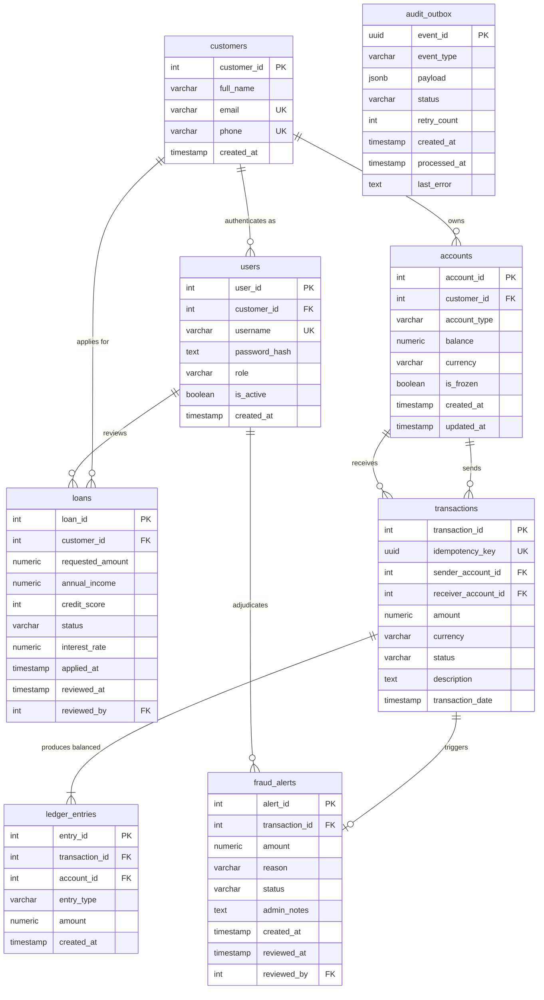

# FinTrack — Database Schema & Relational Specifications

## 1. Entity-Relationship Diagram



---

## 2. Table Specifications

### 2.1 `customers`
Stores primary KYC and identity details for individual bank customers.
* `customer_id` (SERIAL PRIMARY KEY)
* `full_name` (VARCHAR(150) NOT NULL)
* `email` (VARCHAR(254) UNIQUE NOT NULL)
* `phone` (VARCHAR(20) UNIQUE NOT NULL)
* `created_at` (TIMESTAMP DEFAULT CURRENT_TIMESTAMP)

### 2.2 `users`
Stores application credentials, Argon2id password hashes, and system roles.
* `user_id` (SERIAL PRIMARY KEY)
* `customer_id` (INT REFERENCES customers(customer_id) ON DELETE CASCADE, NULL for admin)
* `username` (VARCHAR(50) UNIQUE NOT NULL)
* `password_hash` (TEXT NOT NULL)
* `role` (VARCHAR(20) NOT NULL CHECK (role IN ('ADMIN', 'CUSTOMER')))
* `is_active` (BOOLEAN DEFAULT TRUE)
* `created_at` (TIMESTAMP DEFAULT CURRENT_TIMESTAMP)

### 2.3 `accounts`
Stores bank account records with balances and freeze status.
* `account_id` (SERIAL PRIMARY KEY)
* `customer_id` (INT REFERENCES customers(customer_id) ON DELETE CASCADE)
* `account_type` (VARCHAR(20) NOT NULL CHECK (account_type IN ('SAVINGS', 'CHECKING', 'LOAN_SETTLEMENT')))
* `balance` (NUMERIC(15,2) NOT NULL DEFAULT 0.00 CHECK (balance >= 0.00))
* `currency` (VARCHAR(3) DEFAULT 'INR')
* `is_frozen` (BOOLEAN DEFAULT FALSE)
* `created_at` (TIMESTAMP DEFAULT CURRENT_TIMESTAMP)
* `updated_at` (TIMESTAMP DEFAULT CURRENT_TIMESTAMP)

### 2.4 `transactions`
Records high-level fund transfer requests and execution statuses.
* `transaction_id` (SERIAL PRIMARY KEY)
* `idempotency_key` (UUID UNIQUE NOT NULL)
* `sender_account_id` (INT REFERENCES accounts(account_id))
* `receiver_account_id` (INT REFERENCES accounts(account_id))
* `amount` (NUMERIC(15,2) NOT NULL CHECK (amount > 0.00))
* `currency` (VARCHAR(3) DEFAULT 'INR')
* `status` (VARCHAR(20) NOT NULL CHECK (status IN ('PENDING', 'SUCCESS', 'FAILED', 'FLAGGED')))
* `description` (TEXT)
* `transaction_date` (TIMESTAMP DEFAULT CURRENT_TIMESTAMP)

### 2.5 `ledger_entries`
The append-only double-entry bookkeeping ledger. Every transfer creates exactly two rows (1 DEBIT and 1 CREDIT).
* `entry_id` (SERIAL PRIMARY KEY)
* `transaction_id` (INT REFERENCES transactions(transaction_id) ON DELETE RESTRICT)
* `account_id` (INT REFERENCES accounts(account_id) ON DELETE RESTRICT)
* `entry_type` (VARCHAR(10) NOT NULL CHECK (entry_type IN ('DEBIT', 'CREDIT')))
* `amount` (NUMERIC(15,2) NOT NULL CHECK (amount > 0.00))
* `created_at` (TIMESTAMP DEFAULT CURRENT_TIMESTAMP)

### 2.6 `loans`
Stores loan applications, customer income, credit scores, and review state.
* `loan_id` (SERIAL PRIMARY KEY)
* `customer_id` (INT REFERENCES customers(customer_id) ON DELETE CASCADE)
* `requested_amount` (NUMERIC(15,2) NOT NULL CHECK (requested_amount > 0.00))
* `annual_income` (NUMERIC(15,2) NOT NULL CHECK (annual_income > 0.00))
* `credit_score` (INT NOT NULL CHECK (credit_score BETWEEN 300 AND 900))
* `status` (VARCHAR(20) NOT NULL CHECK (status IN ('PENDING', 'APPROVED', 'REJECTED')))
* `interest_rate` (NUMERIC(5,2) DEFAULT 8.50)
* `applied_at` (TIMESTAMP DEFAULT CURRENT_TIMESTAMP)
* `reviewed_at` (TIMESTAMP)
* `reviewed_by` (INT REFERENCES users(user_id))

### 2.7 `fraud_alerts`
Stores flagged transfers held deterministically for compliance review.
* `alert_id` (SERIAL PRIMARY KEY)
* `transaction_id` (INT REFERENCES transactions(transaction_id))
* `amount` (NUMERIC(15,2) NOT NULL)
* `reason` (TEXT NOT NULL)
* `status` (VARCHAR(20) NOT NULL CHECK (status IN ('OPEN', 'APPROVED', 'REJECTED')))
* `admin_notes` (TEXT)
* `created_at` (TIMESTAMP DEFAULT CURRENT_TIMESTAMP)
* `reviewed_at` (TIMESTAMP)
* `reviewed_by` (INT REFERENCES users(user_id))

### 2.8 `audit_outbox`
PostgreSQL Transactional Outbox table holding security and audit events before ingestion by MongoDB.
* `event_id` (UUID PRIMARY KEY DEFAULT gen_random_uuid())
* `event_type` (VARCHAR(50) NOT NULL)
* `payload` (JSONB NOT NULL)
* `status` (VARCHAR(20) NOT NULL CHECK (status IN ('PENDING', 'PROCESSING', 'DELIVERED', 'FAILED')))
* `retry_count` (INT DEFAULT 0)
* `created_at` (TIMESTAMP DEFAULT CURRENT_TIMESTAMP)
* `processed_at` (TIMESTAMP)
* `last_error` (TEXT)

---

## 3. Database Triggers

### 3.1 `trg_prevent_overdraft` on `accounts` (BEFORE UPDATE)
Enforces balance non-negativity:
```sql
CREATE OR REPLACE FUNCTION fn_prevent_overdraft()
RETURNS TRIGGER AS $$
BEGIN
    IF NEW.balance < 0.00 THEN
        RAISE EXCEPTION 'Negative balance violation: account % would have balance %', NEW.account_id, NEW.balance;
    END IF;
    NEW.updated_at = CURRENT_TIMESTAMP;
    RETURN NEW;
END;
$$ LANGUAGE plpgsql;
```

### 3.2 `trg_enforce_ledger_immutability` on `ledger_entries` (BEFORE UPDATE OR DELETE)
Prevents any alteration or deletion of historical double-entry ledger rows:
```sql
CREATE OR REPLACE FUNCTION fn_enforce_ledger_immutability()
RETURNS TRIGGER AS $$
BEGIN
    RAISE EXCEPTION 'Ledger entries are strictly immutable. Deletions and updates are prohibited.';
END;
$$ LANGUAGE plpgsql;
```

### 3.3 `trg_detect_large_transfer` on `transactions` (AFTER INSERT)
Automatically records large transactions into `audit_outbox`:
```sql
CREATE OR REPLACE FUNCTION fn_detect_large_transfer()
RETURNS TRIGGER AS $$
BEGIN
    IF NEW.amount >= 10000.00 THEN
        INSERT INTO audit_outbox (event_type, payload, status)
        VALUES (
            'LARGE_TRANSFER_DETECTED',
            jsonb_build_object(
                'transaction_id', NEW.transaction_id,
                'sender_account_id', NEW.sender_account_id,
                'receiver_account_id', NEW.receiver_account_id,
                'amount', NEW.amount,
                'currency', NEW.currency
            ),
            'PENDING'
        );
    END IF;
    RETURN NEW;
END;
$$ LANGUAGE plpgsql;
```

---

## 4. Database Views

1. **`View_Account_Summary`**: Aggregates net incoming and outgoing transfer amounts and transaction counts per account.
2. **`View_Transaction_Summary`**: Joins transactions with sender and receiver customer names for statement generation.
3. **`View_Loan_Eligibility`**: Pre-computes debt-to-income and credit rating assessments per customer.
4. **`View_Fraud_Alerts`**: Joins compliance holds with counterparty details and transaction dates for administrator review.

